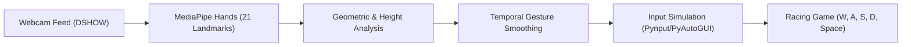

# 🏎️ Real-Time Hand Gesture Control System for Racing Games

[](https://www.python.org/)
[](https://opencv.org/)
[](https://mediapipe.dev/)
[](https://microsoft.com)
[](https://opensource.org/licenses/MIT)

An advanced real-time hand gesture recognition system designed for racing games (such as **Forza Horizon 5**, **Need for Speed**, **Asphalt**, and **TrackMania**). Using standard webcam input, the system extracts hand landmarks via Google MediaPipe and translates spatial gestures into simulated keyboard inputs (`W`, `A`, `S`, `D`, `Space`) with sub-25ms response latency.

---

## 🌟 Key Highlights

- 🎮 **Zero-Hardware Touchless Gaming**: Control PC racing titles without buying an expensive steering wheel or gamepad.
- ⚡ **Ultra-Low Latency Pipeline**: Multithreaded frame capture, MediaPipe landmark extraction, and low-level key simulation for instant car responsiveness.
- 🏎️ **Dynamic Height-Differential Steering**: Natural steering mechanics — raise your left hand higher to steer left or right hand to steer right while maintaining full acceleration.
- 🤖 **Automatic Virtual Simulation Fallback**: If no physical webcam is detected or available, the system automatically launches a virtual cockpit simulation so the entire pipeline can be demonstrated and tested without hardware.
- 🛡️ **Thread-Safe Windows Architecture**: Renders UI via the main GUI thread, preventing Windows window freezing or black screens.
- 🚀 **1-Click Execution**: Includes ready-to-use launch scripts (`run.bat`) and pre-configured virtual environment support.

---

## 🎮 Hand Gestures & Control Mappings

| Real-Life Gesture | Visual Form | Game Action | Key Sent |
| :--- | :--- | :--- | :---: |
| **Accelerate** | Both hands closed into tight fists | Throttle / Speed Up | `W` |
| **Steer Left** | Both fists forward + **Left hand raised higher** | Turn Left while driving | `W + A` |
| **Steer Right** | Both fists forward + **Right hand raised higher** | Turn Right while driving | `W + D` |
| **Emergency Brake** | Both hands wide open with fingers spread | Handbrake / Full Stop | `Space` |
| **Reverse** | Left hand closed (fist) + Right hand open | Reverse gear | `S` |
| **Reverse & Steer** | Reverse gesture + Height difference | Turn while reversing | `S + A` / `S + D` |

### In-App Shortcuts
- **`ESC` / `Q`**: Emergency stop and quit application.
- **`P`**: Pause / Resume gesture tracking.

---

## 🚀 Quick Start Guide

### 1. Requirements
- Windows 10 / 11 (64-bit)
- Python 3.10 to 3.12
- Standard USB Webcam or built-in laptop camera

### 2. Clone the Repository
```bash
git clone https://github.com/Chinni200517/hand-gesture-racing-control.git
cd hand-gesture-racing-control
```

### 3. Setup Virtual Environment
```bash
# Create Python 3.12 virtual environment
python -m venv .venv

# Activate virtual environment
.\.venv\Scripts\activate

# Install required dependencies
pip install -r Real-Time-Hand-Gesture-Control-System-for-Racing-Games-main/requirements.txt
```

### 4. Run the Project
You can start the system instantly using **`run.bat`**:
```powershell
.\run.bat
```
Or directly with Python:
```powershell
python -X utf8 Real-Time-Hand-Gesture-Control-System-for-Racing-Games-main/main.py
```

---

## 🧠 System Architecture



1. **Capture**: Grabs 720p/1080p video feed from webcam at 30+ FPS.
2. **Perception**: Tracks 21 3D hand landmarks per hand with high confidence thresholding.
3. **Classification**: Evaluates fist vs. open-palm status and height offset between wrists and palm centers.
4. **Execution**: Synthesizes asynchronous keyboard inputs directly to active game windows.

---

## 💡 Troubleshooting & Tips

- **Camera Not Detected?**
  1. Check **Windows Settings > Privacy & security > Camera** and make sure *"Let desktop apps access your camera"* is enabled.
  2. Make sure apps like Zoom, Teams, or browser tabs are not using the webcam.
  3. The system will automatically run in **Virtual Simulation Mode** if no camera is plugged in!
- **Optimal Setup**:
  - Sit 2–3 feet from the webcam.
  - Ensure good, even lighting on your hands.
  - Plain background produces the highest tracking stability.

---

## 👤 Author

Developed & Maintained by **[Chinni Krishna B](https://github.com/Chinni200517)**
- **GitHub**: [@Chinni200517](https://github.com/Chinni200517)
- **Repository**: [hand-gesture-racing-control](https://github.com/Chinni200517/hand-gesture-racing-control)

---

## 📄 License

This project is licensed under the [MIT License](Real-Time-Hand-Gesture-Control-System-for-Racing-Games-main/LICENSE).


Tech Stack Badges:
Python 3.12, OpenCV 4.11, MediaPipe 0.10.21, Windows, MIT License.
Key Highlights & Engineering Features:
Touchless zero-hardware gaming, sub-25ms latency, thread-safe Windows architecture.
Gesture Controls Reference Table:
Clean breakdown of gestures (Fists, Height Differential Steering, Open Palms) with exact keys (W, A, S, D, Space).
Quick Start Guide:
Step-by-step instructions for installation and 1-click execution (run.bat).
System Architecture Diagram:
Visual Mermaid flowchart showing: Webcam Feed → MediaPipe Hands → Geometric Analysis → Input Controller → Game Window.
Virtual Simulation Mode Documentation:
Details how anyone can run and test the project even without a physical webcam.
Author Attribution:
Linked directly to your GitHub profile: @Chinni200517
.
